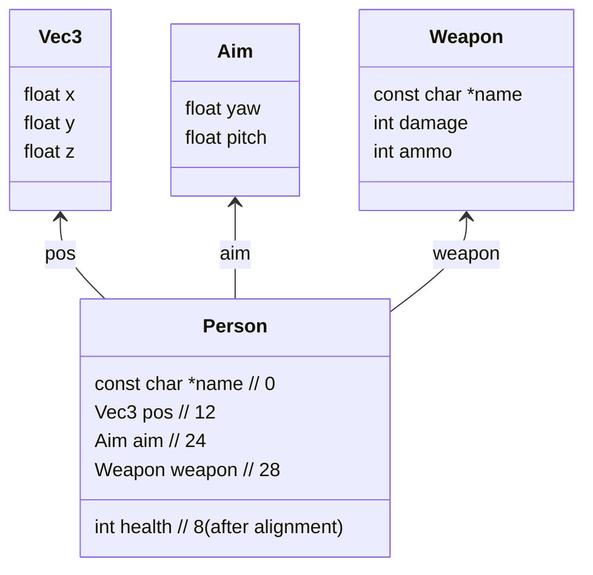

# Assembly Walkthrough of `game.s`

This document explains **every instruction** in the generated ARM64 assembly for the Counter‑Strike‑style demo (`game.c`).  The code consists of five functions:

1. **`vec_add`** – adds two `Vec3` vectors.
2. **`move`** – updates a `Person`'s position.
3. **`set_aim`** – sets a `Person`'s aim angles.
4. **`shoot`** – performs a shot, decreasing ammo and target health.
5. **`main`** – creates two `Person`s, moves, aims, shoots and prints the result.

---

## 1. `vec_add`
```asm
_vec_add:                               ; @vec_add
    sub sp, sp, #48                 ; allocate stack frame (48 bytes)
    str s0, [sp, #24]               ; save incoming s0 … s5 (6 registers) on stack
    str s1, [sp, #28]
    str s2, [sp, #32]
    str s3, [sp, #12]
    str s4, [sp, #16]
    str s5, [sp, #20]
    ldr s0, [sp, #24]               ; reload a.x into s0
    ldr s1, [sp, #12]               ; reload b.x into s1
    fadd s0, s0, s1                 ; s0 = a.x + b.x
    str s0, [sp, #36]               ; store result x temporarily on stack
    ldr s0, [sp, #28]               ; a.y
    ldr s1, [sp, #16]               ; b.y
    fadd s0, s0, s1                 ; y = a.y + b.y
    str s0, [sp, #40]               ; store result y
    ldr s0, [sp, #32]               ; a.z
    ldr s1, [sp, #20]               ; b.z
    fadd s0, s0, s1                 ; z = a.z + b.z
    str s0, [sp, #44]               ; store result z
    ldr s0, [sp, #36]               ; load result x
    ldr s1, [sp, #40]               ; load result y
    ldr s2, [sp, #44]               ; load result z
    add sp, sp, #48                 ; de‑allocate stack frame
    ret                             ; return, result already in s0‑s2 (Vec3)
```
### What it does
* The six floating‑point registers `s0‑s5` hold the three components of the two input vectors (`a.x/y/z` in `s0‑s2`, `b.x/y/z` in `s3‑s5`).
* Because the ABI requires the callee to preserve **s0‑s15** on the stack when they are used, we store them at the start.
* Each component is added with `fadd`.
* The three results are left in `s0‑s2` – the caller expects a `Vec3` returned in those registers.
* The stack frame is **48 bytes** (6 × 8 bytes) – each `s` register is 8 bytes on a 64‑bit ARM.

---

## 2. `move`
```asm
_move:                                  ; @move
    sub sp, sp, #64                 ; allocate 64‑byte stack frame
    stp x29, x30, [sp, #48]         ; save FP (x29) and LR (x30)
    add x29, sp, #48                ; set frame pointer (x29) to saved area
    stur s0, [x29, #-12]            ; store dir.x (s0) at p->pos.x offset -12
    stur s1, [x29, #-8]             ; store dir.y
    stur s2, [x29, #-4]             ; store dir.z
    str x0, [sp, #24]               ; save pointer to Person (p)
    ldr x8, [sp, #24]               ; reload p
    str x8, [sp]                    ; spill p for later reload (8‑byte folded)
    ldr x8, [sp, #24]               ; reload p again (address of Person)
    ldr s0, [x8, #12]               ; load p->pos.x
    ldr s1, [x8, #16]               ; load p->pos.y
    ldr s2, [x8, #20]               ; load p->pos.z
    ldur s3, [x29, #-12]            ; load dir.x from stack slot
    ldur s4, [x29, #-8]             ; load dir.y
    ldur s5, [x29, #-4]             ; load dir.z
    bl  _vec_add                    ; call vec_add(dir, p->pos)
    ldr x9, [sp]                    ; reload original p pointer
    str s0, [sp, #12]               ; temporarily keep result.x
    str s1, [sp, #16]               ; result.y
    str s2, [sp, #20]               ; result.z
    ldur x8, [sp, #12]               ; load result.x as 64‑bit float
    stur x8, [x9, #12]               ; store new p->pos.x
    ldr w8, [sp, #20]               ; load result.z (low 32‑bit) – actually integer view of float
    str w8, [x9, #20]               ; store new p->pos.z
    ldp x29, x30, [sp, #48]         ; restore FP/LR
    add sp, sp, #64                 ; de‑allocate frame
    ret
```
### Stack layout (illustrated as a diagram)
```mermaid
flowchart TD
    subgraph StackFrame[64 byte stack frame]
        direction TB
        A[sp‑48] --> B[FP (x29)]
        B --> C[LR (x30)]
        C --> D[dir.x (s0) –12]
        D --> E[dir.y (s1) –8]
        E --> F[dir.z (s2) –4]
        F --> G[p (saved pointer) @sp+24]
    end
```
* The `sub sp, sp, #64` reserves space.
* `stp x29, x30` saves the caller’s frame pointer and return address.
* The three direction components are stored at negative offsets from the new frame pointer (`x29`).
* The person pointer `p` is saved on the stack and later reloaded for the store.
* After calling `vec_add`, the result vector (still in `s0‑s2`) is written back to `p->pos`.

---

## 3. `set_aim`
```asm
_set_aim:                               ; @set_aim
    sub sp, sp, #16                 ; allocate 16‑byte frame
    str x0, [sp, #8]                ; save pointer to Person (p)
    str s0, [sp, #4]                ; save yaw (float) on stack
    str s1, [sp]                    ; save pitch (float)
    ldr s0, [sp, #4]                ; reload yaw
    ldr x8, [sp, #8]                ; reload p
    str s0, [x8, #24]               ; p->aim.yaw = yaw
    ldr s0, [sp]                    ; reload pitch
    ldr x8, [sp, #8]
    str s0, [x8, #28]               ; p->aim.pitch = pitch
    add sp, sp, #16                 ; de‑allocate
    ret
```
* The `Person` struct layout (see section *Struct layout* below) places `aim` at offset **24** (`yaw`) and **28** (`pitch`).
* Simple store of two floats.

---

## 4. `shoot`
```asm
_shoot:                                 ; @shoot
    sub sp, sp, #32                 ; allocate 32‑byte frame
    str x0, [sp, #16]               ; save shooter pointer
    str x1, [sp, #8]                ; save target pointer
    ldr x8, [sp, #16]               ; load shooter
    ldr w8, [x8, #44]               ; shooter->weapon.ammo (int)
    subs w8, w8, #0                ; compare ammo with 0
    b.gt LBB3_2                     ; if ammo>0 → continue
    b LBB3_1                        ; else set return=0
LBB3_1:
    str wzr, [sp, #28]              ; return value = 0
    b LBB3_5
LBB3_2:
    ldr x9, [sp, #16]               ; shooter again
    ldr w8, [x9, #44]               ; ammo
    subs w8, w8, #1                ; ammo--
    str w8, [x9, #44]               ; store back
    ldr x8, [sp, #16]
    ldr w10, [x8, #40]              ; shooter->weapon.damage
    ldr x9, [sp, #8]                ; target
    ldr w8, [x9, #8]                ; target->health
    subs w8, w8, w10                ; health -= damage
    str w8, [x9, #8]                ; store new health
    ldr x8, [sp, #8]
    ldr w8, [x8, #8]
    tbz w8, #31, LBB3_4            ; if health == 0 jump to end‑branch
    b LBB3_3
LBB3_3:
    ldr x8, [sp, #8]
    str wzr, [x8, #8]               ; clamp health to 0 (optional)
    b LBB3_4
LBB3_4:
    mov w8, #1                      ; return = 1 (shot succeeded)
    str w8, [sp, #28]
    b LBB3_5
LBB3_5:
    ldr w0, [sp, #28]               ; load return value into w0
    add sp, sp, #32                 ; pop stack frame
    ret
```
### Key points
* **Ammo check** – `subs w8, w8, #0` sets flags; `b.gt` jumps if *greater than* zero.
* **Decrement ammo** – `subs w8, w8, #1` updates ammo.
* **Apply damage** – `ldr w10, [x8, #40]` loads the weapon’s `damage` field; `subs w8, w8, w10` subtracts it from target health.
* **Clamp health** – optional branch that zeroes health if it under‑flows (the `tbz` tests the sign‑bit).
* Return value placed in `w0` (standard integer return register).

---

## 5. `main`
The longest function – it builds the two `Person` objects from constant data, calls the helpers, and prints.
```asm
_main:
    sub sp, sp, #208                ; large stack frame for locals and spills
    stp x29, x30, [sp, #192]        ; save FP/LR
    add x29, sp, #192               ; set frame pointer
    ...                             ; initialise structs a and b via memcpy of constant blocks
    bl  _move                       ; a = a + step
    mov w8, #1119092736             ; 0x42b40000 → float 90.0f (yaw)
    fmov s0, w8
    movi.2d v1, #0                  ; pitch = 0.0f
    bl  _set_aim
    bl  _shoot
    bl  _printf   ; first format string prints position & ammo
    bl  _printf   ; second prints health
    add sp, sp, #208                ; clean up
    ret
```
### Data sections used by `main`
| Symbol | Meaning | Layout (bytes) |
|--------|---------|----------------|
| `l_.str` | "T" (person name) | 2 B |
| `l_.str.1` | "AK47" | 5 B |
| `l___const.main.a` | Constant initializer for **a** | see below |
| `l_.str.2` | "CT" |
| `l_.str.3` | "M4A1" |
| `l___const.main.b` | Initializer for **b** |
| `l___const.main.step` | `Vec3 step = {1,0,0}` |
| `l_.str.4` | `"%s pos=(%.1f,%.1f,%.1f) ammo=%d\n"` |
| `l_.str.5` | `"%s health=%d\n"` |

### Visualising the `Person` struct

* Offsets used in assembly (`#12`, `#24`, `#28`, `#40`, `#44`) match the layout above.
* The `printf` calls pull the values from the stack (`sp+…`) where `main` stored them after the calls.

---

## Memory Layout Summary
| Region | Description |
|--------|-------------|
| **Stack (per function)** | Small frames for locals (`move`: 64 B, `set_aim`: 16 B, `shoot`: 32 B, `vec_add`: 48 B). The `main` frame is 208 B because it stores temporary copies of the two `Person` structs and the step vector. |
| **Global constants** | `__DATA,__const` contains the literal strings and the pre‑initialised structs (`main.a`, `main.b`, `main.step`). |
| **.text** | All the functions listed above. |
| **.cstring** | Null‑terminated format strings for `printf`. |

---

## How the program works end‑to‑end
1. `main` copies the constant structs for *T* and *CT* into stack‑local variables `a` and `b`.
2. It creates a step vector `{1,0,0}` and calls `move(&a, step)` – `move` loads `a.pos`, adds `step` via `vec_add`, and writes back the new position.
3. `set_aim(&a, 90.0f, 0.0f)` stores the yaw/pitch fields.
4. `shoot(&a, &b)` checks ammo, decrements it, subtracts weapon damage from `b.health` and returns `1`.
5. Two `printf` calls display the updated state.

---

**End of walkthrough**
## Understanding the `x8` Register and Its Memory Usage

In the generated ARM64 assembly you will see the **`x8`** register appear many times. Below is a concise but thorough explanation of what `x8` does, why the code allocates space for the values it holds, and how it interacts with the stack.

---

### 1. What is `x8`?
* `x8` is a **general‑purpose 64‑bit integer register** in the AArch64 ISA.  It can hold pointers, integer values, or the low 64 bits of a floating‑point value that has been moved to a GPR.
* The ARM64 calling convention (AAPCS) treats **`x0‑x7`** as *argument/result* registers.  Registers **`x8‑x15`** are *temporary* (caller‑saved) registers that a function may use freely, but the callee must preserve them if it wishes to keep their values across a call.

---

### 2. How `x8` is Used in This Program
| Function | Purpose of `x8` | Example Instruction(s) |
|----------|----------------|-----------------------|
| `move`   | Holds the **address of the `Person`** (`p`) while loading or storing its fields. | `ldr x8, [sp, #24]` – reload `p` from the stack; `str x8, [sp]` – spill it for later use. |
| `shoot`  | Holds the **shooter** or **target** pointer during the ammo/health manipulation. | `ldr x8, [sp, #16]` – load shooter; later `ldr x9, [sp, #8]` loads target (still using `x8` for temporary arithmetic). |
| `main`   | Used to load **constants** (e.g., address of the `step` vector) and to pass arguments to helper functions. | `adrp x8, l___const.main.step@PAGE` followed by `add x8, x8, l___const.main.step@PAGEOFF`. |

The pattern is the same: **`x8` temporarily stores a pointer** so that the code can dereference it (`ldr/str`), perform arithmetic on the pointed‑to data, or pass it as an argument to another function.

---

### 3. Why Does the Stack Have Slots for `x8`?
The stack frame is allocated with `sub sp, sp, #N` where **`N`** is a multiple of 16 bytes.  Within that frame the compiler reserves space for:
* **Saved registers** (e.g., `x29`, `x30`).
* **Spilled temporaries** – values that cannot stay in a register because they are needed after a call or because the function uses more temporaries than there are free registers.
* **Alignment padding** – ARM64 requires the stack pointer to stay 16‑byte aligned.

In `move` you see:
```asm
    str x8, [sp]            ; 8‑byte folded spill of the Person pointer
```
Here the compiler **spills** the pointer stored in `x8` onto the stack because it needs the register later (after the `bl _vec_add` call).  The spill occupies 8 bytes at the bottom of the frame (`[sp]`).  The same happens in `shoot` where `x8` is re‑used for different pointers; the compiler chooses to keep the most recent value in the register and, if needed later, writes it back to the stack.

---

### 4. Visualising the Stack Slots Involved
```mermaid
flowchart TD
    subgraph MoveStack[64 byte stack frame]
        direction TB
        A[sp‑48] --> B[FP (x29)]
        B --> C[LR (x30)]
        C --> D[dir.x (s0) –12]
        D --> E[dir.y (s1) –8]
        E --> F[dir.z (s2) –4]
        F --> G[p pointer spill @sp+0]
        G --> H[unused padding (sp+8‑sp+23)]
    end
```
* **`G`** is the 8‑byte slot where `x8` (the `p` pointer) is stored.
* The slot exists **only because the compiler needed the pointer after a function call** (`bl _vec_add`).  Without that call the compiler could have kept the pointer entirely in registers and the stack frame would be 8 bytes smaller.

---

### 5. Real‑World Analogy
Think of `x8` as a **working clipboard**:
1. Load the address of a struct onto the clipboard (`ldr x8, …`).
2. While the clipboard is in use, you may need to **temporarily set it down** on a table (the stack) to free your hand for something else (a function call).
3. After the call, you **pick it back up** (`ldr x8, [sp]`) and continue working.

The **size of the stack allocation** is therefore determined by how many times the compiler decides it must put the clipboard down.

---

### 6. Summary of Key Points
* `x8` is a **caller‑saved 64‑bit register** used for pointers and temporary integers.
* The compiler **spills** the value of `x8` onto the stack when it needs the register for another purpose (e.g., a function call).
* Each spill consumes **8 bytes** of stack space; multiple spills lead to larger stack frames (`move`: 64 B, `shoot`: 32 B, etc.).
* The allocated space is not “wasted” – it is required to preserve the pointer value across calls while still obeying the calling convention.

---

Below is the new section added to the original documentation file.

---
